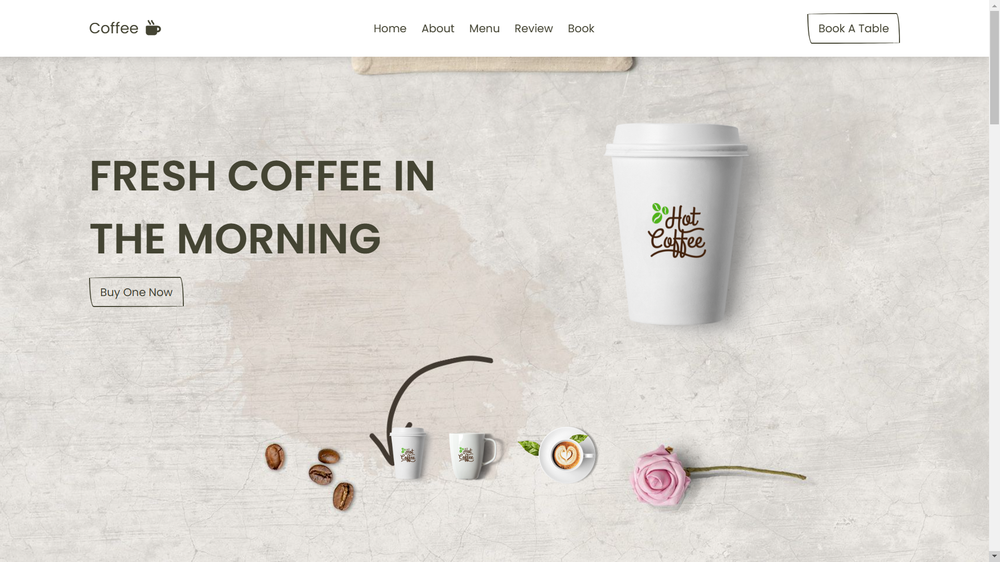

# De Kitchen - Modern Gourmet Restaurant & Online Ordering Platform

A modern, high-performance **Next.js 14 App Router** web application built with **TypeScript**, **Tailwind CSS**, and **Supabase**.



---

## ✨ Features & Pages

- 🏠 **Home (`/`):** Hero section with interactive dish switcher, core pillars, featured chef specials, customer reviews, and dine-in reservation banner.
- 🍔 **Menu Catalog (`/menu`):** Fast live category filtering (Burgers, Pizzas, Sides, Drinks, Desserts), search by dish name, sorting by rating & price, and quick-add to cart.
- 🛠️ **Food Details & Customizer (`/menu/[id]`):** Interactive variation selector (patty size, crust style), optional add-ons with live price delta recalculation, kitchen special instructions, and recommendations.
- 🛒 **Cart Drawer & Page (`/cart`):** Persistent cart state with slide-over drawer, quantity controls, promo vouchers (`DEKITCHEN10`), tax & delivery fee calculations.
- 💳 **Checkout (`/checkout`):** Seamless checkout flow for Doorstep Delivery or Self Pickup, customer contact info, and multiple payment methods (Cash on Delivery, Credit/Debit Card test interface, Online Bank Transfer).
- 🎉 **Order Confirmation (`/order-confirmation/[id]`):** Instant confirmation receipt, unique Order ID badge (e.g. `DK-94821`), and direct WhatsApp notification button.
- 🚚 **Order Tracking (`/track-order` & `/track-order/[id]`):** Real-time 5-stage progress visualizer (Placed → Accepted → Cooking → Out for Delivery → Delivered) with courier details and live status refresh.
- 📖 **About Us (`/about`):** Kitchen story, certified fresh ingredients commitment, and culinary principles.
- 📅 **Table Reservation & Contact (`/contact`):** Instant table booking form and direct contact details.
- 🛡️ **Admin Dashboard (`/admin`):**
  - **Overview (`/admin`):** Real-time gross sales revenue, total order volume, active kitchen queue, and status pipeline breakdown.
  - **Order Management (`/admin/orders`):** Filter by status, search by customer, direct click-to-call / click-to-WhatsApp, and instant status progression.
  - **Menu & Price Control (`/admin/menu`):** In-stock toggle, price editing, and new food dish creator.
  - **Admin Security (`/admin/login`):** Protected by manager passcode (`admin123`).

---

## 🚀 Quick Start

1. Install dependencies:
   ```bash
   npm install
   ```

2. Run development server:
   ```bash
   npm run dev
   ```

3. Open [http://localhost:3000](http://localhost:3000) in your browser.

4. Log into the Admin Dashboard at [http://localhost:3000/admin](http://localhost:3000/admin) with passcode `admin123`.

---

## 🗄️ Database Setup (Supabase)

See the detailed instructions in [DEPLOYMENT.md](file:///c:/Users/student/Desktop/DeKitchen-main/DEPLOYMENT.md) for running `supabase/schema.sql` and linking your Supabase credentials in `.env.local`.

---

## 👨‍💻 Credits

- Developed for: **De Kitchen**
- Agency: **MediumMinds** ([www.mediumminds.com](https://www.mediumminds.com))
- Developer: **Umar Farooq**
